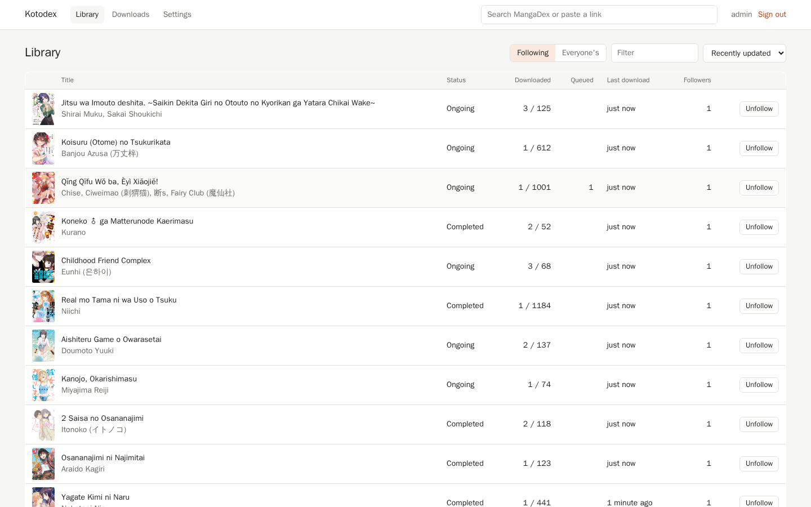
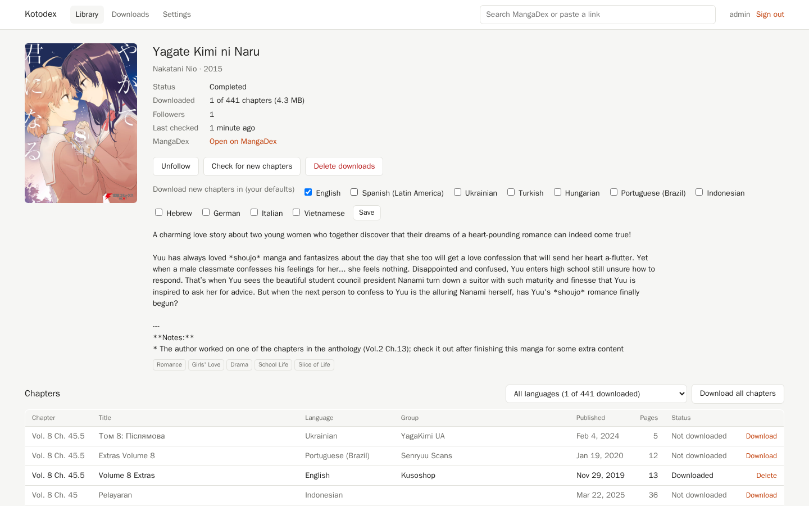
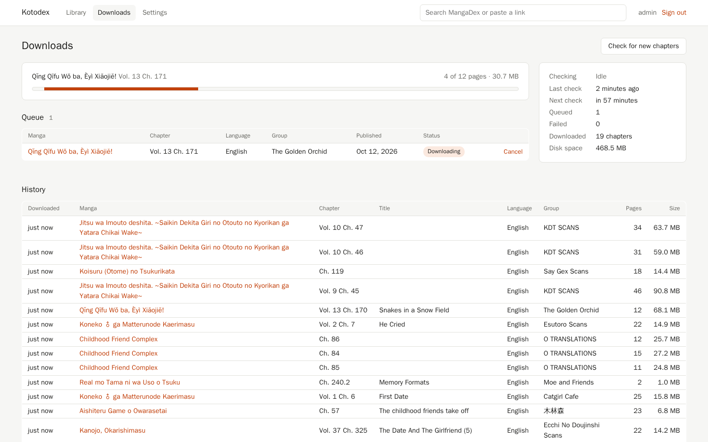

# Kotodex

Follow manga on MangaDex and have new chapters downloaded to your own server, then read them in [Kotatsu](https://github.com/KotatsuApp/Kotatsu) on your phone. Kotodex is a small Go server with a web page for following manga, plus a plugin app that adds the server as a source in Kotatsu.

<p>
  
  
  
</p>

## Features

- Follow manga from a MangaDex search or a pasted MangaDex link, and Kotodex downloads new chapters as they come out.
- Link a MangaDex account to follow everything you already follow there.
- Read downloaded chapters in Kotatsu, with its favorites, history, and new chapter notifications working like any other source.
- Give each person their own account with their own follows, and see or sign out the devices on each account.
- Pick which languages to download for each manga you follow, and download a manga's whole back catalog in one language from its page.

Kotodex only downloads chapters that come out after you follow a manga. To grab the older ones, pick a language on the manga's page and use "Download all", e.g. "Download all English chapters". When two groups upload the same chapter, Kotodex downloads the first upload and lists the other one so you can download it by hand.

Kotatsu only shows chapters that are already on the server. Kotatsu shows queued chapters once Kotodex finishes downloading them.

## Usage

Start the server and sign in at `http://<server>:8080` as `admin`. Search MangaDex from the box at the top and press Follow on anything you want. Kotodex checks followed manga every hour by default. The Downloads page shows what's queued and lets you start a check right away.

To read on your phone, install the plugin APK, open it, and sign in with the server address and your Kotodex username and password. Kotodex then shows up pinned at the top of Explore in Kotatsu.

- If you want to see only your own follows in Kotatsu instead of everyone's, turn on "Only manga I follow" in the plugin app.
- If you use a Kotatsu fork, it gets an error the first time it opens Kotodex. Open the plugin app and press Allow next to it. Kotodex only answers apps you allowed, plus Kotatsu itself.
- Changing your password signs out every device, including Kotatsu. Sign in again in the plugin app afterwards.
- Kotodex signs out devices that go unused for 90 days. If you haven't opened Kotodex in Kotatsu for that long, sign in again in the plugin app.
- Linking a MangaDex account needs a personal API client. Create one on mangadex.org under Settings, API Clients, and wait for it to be approved.
- With a linked MangaDex account, Kotodex follows whatever you follow on MangaDex. Following or unfollowing something in Kotodex overrides that for one manga, and the reset button next to Follow on the manga's page goes back to matching MangaDex. Kotodex never changes your follows on MangaDex.
- MangaDex chapters from official publishers only link to the publisher's site. Kotodex can't download those and leaves them out.

Set your usual languages under Settings. Every manga you follow uses those unless you pick languages for it on the manga's page. The reset button there goes back to your usual ones. When people follow the same manga in different languages, Kotodex downloads every language someone wants and keeps one copy of each chapter.

Admins can add users and change how often to check under Settings.

If you forget the admin password, set a new one from the command line:

```bash
kotodex user passwd admin new-password
# or with Docker
docker compose exec kotodex /kotodex user passwd admin new-password
```

## Requirements

- Somewhere to run the server (Docker, or any Linux, macOS, or Windows machine)
- Kotatsu on Android 8.0 or newer for the plugin

## Installation

### With Docker

Edit `KOTODEX_ADMIN_PASSWORD` in `compose.yaml`, then:

```bash
docker compose up -d
```

Downloads and the database end up in the `kotodex-data` volume. To build the image yourself instead, replace the `image:` line with `build: ./server`.

### With systemd

Grab `kotodex-<version>-linux-amd64` (or `-arm64`) from the latest release, or build the server (see below). Copy it to `/usr/local/bin/kotodex`, then:

```bash
sudo cp contrib/kotodex.service /etc/systemd/system/
sudo systemctl enable --now kotodex
journalctl -u kotodex
```

If `KOTODEX_ADMIN_PASSWORD` isn't set, Kotodex prints a generated admin password to the log on first start. Data goes in `/var/lib/kotodex`.

### Plugin

Grab the APK from the latest release and install it on the phone that has Kotatsu.

## Configuration

The server reads these environment variables:

| Variable | Default | |
|---|---|---|
| `KOTODEX_DATA_DIR` | `./data` | Database and downloaded chapters |
| `KOTODEX_LISTEN` | `:8080` | Address and port to listen on |
| `KOTODEX_ADMIN_PASSWORD` | random | Password for the `admin` user created on first start |
| `KOTODEX_SECRET` | `secret.key` | Server key, at least 32 characters. Use it to keep the key out of the data directory, e.g. with Docker secrets |

Kotodex keeps its key in `secret.key` in the data directory, apart from the database. The key signs image links and encrypts linked MangaDex accounts. A copy of the database alone can't be used for either. Back up `secret.key` somewhere other than your database backups. If you lose it, link MangaDex accounts again. Kotatsu picks up new image links the next time it opens each manga.

To put Kotodex behind a reverse proxy, forward the `Host` header and set `X-Forwarded-Proto`. The plugin works over plain HTTP on a home network too.

## How to build

Server (Go 1.26 or newer):

```bash
cd server
go build -o kotodex .
go test ./...
```

Plugin (JDK 17 or newer and the Android SDK):

```bash
cd plugin
./gradlew assembleRelease
```

The APK ends up in `plugin/app/build/outputs/apk/release/`. `./gradlew testDebugUnitTest` renders the plugin's screens to `plugin/app/build/screenshots/`.

## Network activity

The server connects to:

- `api.mangadex.org` and `auth.mangadex.org` for search, chapter lists, and account follows
- `uploads.mangadex.org` for covers
- MangaDex@Home image servers (`*.mangadex.network`) for pages, and `api.mangadex.network` to report how each page download went, which MangaDex requires

The plugin only connects to your Kotodex server.
